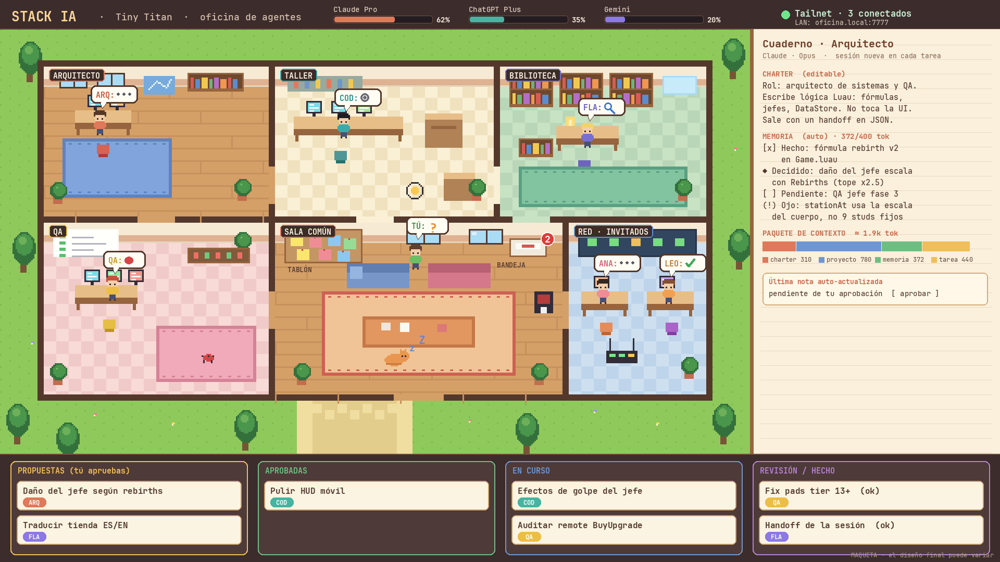

# Stack IA — oficina de agentes de desarrollo

> Documento de diseño (2026-11-04). La primera versión implementa solo el núcleo: chat, contexto automático, tareas y ramas. La oficina visual aún no existe.
> Maqueta visual: [`maqueta-oficina.png`](../mockups/maqueta-oficina.png)



---

## 1. Qué queremos

Un entorno de desarrollo **agéntico** con forma de juego: una oficina cozy en pixel art donde cada agente de IA es un personaje con un rol y un escritorio. El dueño (tú) no escribe todo el código: **aprueba propuestas y elige qué se trabaja**, y los agentes ejecutan.

Metas:

1. **Contexto limpio por agente.** Cada uno tiene una responsabilidad clara, así que menos mezcla de temas y menos bugs.
2. **Poder hacer `/clear` siempre.** Ninguna tarea depende de una conversación larga; el contexto se reconstruye desde archivos pequeños que se mantienen solos.
3. **Gastar pocos tokens.** Orquestación con código normal (no con una IA), contextos de ~2k tokens y modelos baratos para el trabajo mecánico.
4. **Funcionar con suscripciones**, no con APIs de pago: Claude Pro, ChatGPT Plus y Gemini (vía Antigravity).
5. **Linux y Windows**, configurable (roles, modelos, límites).
6. **Multiusuario:** que amigos o el equipo de desarrollo lo usen **por LAN o Tailscale**.

No-metas (por ahora): ser un producto público, ni más de ~6–7 agentes activos a la vez.

---

## 2. Agentes y roles (propuesta inicial)

Un agente = un **charter** (rol y reglas) + una **tarjeta de memoria**. No es un proceso permanente; un agente inactivo no gasta tokens.

| Rol | Modelo / CLI | Qué hace | Cuándo trabaja |
|---|---|---|---|
| **Arquitecto / QA** | Claude (`claude -p`) | Lógica, fórmulas, diseño, aprobación final | Poco, tareas de alto valor |
| **Implementador** | Codex (`codex exec`) | Código, UI y visuales; agente de volumen | Mucho |
| **Bibliotecario / handoffs** | Gemini Flash (`agy`), esfuerzo bajo | Localizar archivos, resumir sesiones, compactar memoria | Al final de cada tarea |
| **Triage y mecánico** | Gemini Flash (`agy`) | Logs, renombrados, docs, changelogs | Bajo demanda |
| **QA / auditoría** | Flash + comprobaciones deterministas; Claude para lo crítico | Revisar remotes, datos, seguridad | Cuando se toca algo sensible |
| **Especialistas** (audio, localización, arte) | Según el caso | Tareas puntuales | Bajo demanda, "duermen" el resto del tiempo |

**Regla:** lo que no se puede verificar de forma barata no se delega a un modelo barato. Arquitectura, fórmulas de economía, DataStore, validación de remotes y la aprobación final se quedan en Claude o Codex.

---

## 3. Contexto vivo (lo que permite el `/clear`)

Cada ejecución arranca una **sesión nueva** con un "paquete de contexto" armado por código:

| Capa | Quién la escribe | Tamaño objetivo |
|---|---|---|
| **Charter del agente** (rol, reglas, archivos permitidos, formato de salida) | Tú, desde el juego | ~300 tok |
| **Brief del proyecto** (objetivo, mapa de arquitectura, decisiones fijadas, convenciones, estado) | Auto | ~800 tok |
| **Tarjeta de memoria del agente** (qué hizo, pendientes, trampas aprendidas) | Auto | ~400 tok |
| **Brief de la tarea** (lo aprobado + criterios de aceptación) | Enrutador + tú | variable |

Total: unos **2.000 tokens** (estimación, sin medir todavía), frente a decenas de miles de una conversación larga.

### Actualización automática

1. Al terminar, el agente devuelve **JSON estructurado**: qué hizo, decisiones nuevas, pendientes, cambios a su memoria.
2. El orquestador lo **contrasta con `git diff`**. Si el agente dice haber tocado un archivo que no cambió, se marca.
3. Todo se añade a `journal.jsonl` (append-only, **nunca se resume**).
4. Si una tarjeta supera su límite, Flash la **compacta**. Las decisiones fijadas no se borran hasta que otra las reemplace.
5. Los cambios de memoria llegan a la **bandeja** y los apruebas tú, para que no se degrade sin que lo notes.

### Prompts que "se quedan"

De las mismas fuentes se **generan** los archivos que cada CLI lee por sí solo:

- `CLAUDE.md` → Claude
- `AGENTS.md` → Codex
- equivalente para `agy` (**por comprobar** qué archivo lee automáticamente)

Así, aunque abras un CLI a mano fuera del juego, ya trae el contexto resumido y al día. Los `HANDOFF*.md` actuales de Tiny Titan pasarían a ser generados.

### Estructura de datos (`.office/` dentro de cada proyecto)

```
.office/
  project.md          brief del proyecto (auto, ~800 tok)
  agents/
    arquitecto/charter.md
    arquitecto/memory.md
    ...
  tasks.json          tablero: propuestas → aprobadas → en curso → revisión → hecho
  journal.jsonl       registro permanente
  inbox/              propuestas de memoria pendientes de aprobar
  config.json         modelos por rol, límites, red
```

Archivos de texto: versionables con git, legibles por cualquier agente, iguales en Linux y Windows.

---

## 3b. Personalización: cualquier proyecto, cualquier agente

Tiny Titan es el primer proyecto, pero la herramienta es **genérica**: nada de Roblox, Luau ni Rojo va dentro del núcleo.

**Proyectos**
- Cada proyecto tiene su carpeta `.office/` y su `config.json`; se pueden abrir varios y cambiar entre ellos.
- **Plantillas de proyecto** (conjuntos de roles ya preparados): *Roblox/Rojo* (la de Tiny Titan), *Web*, *Juego genérico*, *En blanco*.
- Las comprobaciones automáticas (qué cuenta como "verde") se declaran por proyecto: `rojo build`, `npm test`, el linter que toque, etc.

**Agentes**
- Crear, duplicar, renombrar o borrar agentes desde el juego (el personaje, el color y la sala también son configurables).
- Cada agente tiene su **prompt propio** (el charter), editable en cualquier momento desde su cuaderno, con tres partes:
  1. **Rol y reglas** (texto libre, el prompt que tú escribes).
  2. **Alcance:** carpetas y archivos que puede tocar, y comandos permitidos.
  3. **Modelo y esfuerzo:** Claude, Codex o `agy`/Flash, con el nivel de esfuerzo.
- Un cambio de prompt se aplica a la siguiente ejecución. Se guarda un **historial de versiones** del charter para poder volver atrás.
- Además del prompt fijo, puedes dejarle una **nota puntual** a un agente ("para la próxima tarea, ten en cuenta X"), que se archiva sola cuando la usa.

**Proyecto-agnóstico por diseño:** el orquestador solo conoce *tareas, charters, memoria, ramas y comprobaciones*; todo lo específico de un tipo de proyecto vive en la plantilla.

---

## 3c. Panel de control (control total y transparencia)

Un botón de la oficina (o la tecla `Tab`) abre el **Panel de control** sobre el juego. Nada de lo que hace la app queda oculto ni sin posibilidad de corregirlo.

| Pestaña | Qué permite |
|---|---|
| **Chat** | Hablar con cada agente, por tarea o en charla libre, sin tocar su prompt (ver §3f). |
| **Agentes** | Por agente: editar su **prompt** (charter) con historial y comparación de versiones; editar su **archivo de memoria** en bruto; elegir **qué archivos lee** como contexto (añadir, quitar, reordenar, con el coste en tokens de cada uno); **proveedor, modelo y esfuerzo** (las listas salen de cada CLI cuando sea posible); comandos permitidos y alcance. |
| **Contexto** | **Vista previa exacta** de lo que recibirá el agente en su próxima ejecución, con el recuento de tokens por capa (charter, proyecto, memoria, tarea) frente a su presupuesto. Avisa si algo se pasa. Botón de **simulacro** (ver sin ejecutar). Cada ejecución guarda el **prompt real que se envió**, para revisarlo después. |
| **Limpiezas** | **Cuándo y por qué se limpia el contexto de cada agente:** contexto actual frente al tope de cada agente, cuánto hace que empezó la sesión, historial de limpiezas con su motivo (tarea terminada, manual, tope alcanzado, cambio de prompt, error), botón de limpiar ahora, y avisos opcionales (notificación en pantalla, confirmar antes de una auto-limpieza). Antes de limpiar siempre se guarda el handoff. En la oficina, cada personaje muestra su contexto (`14k/60k`) y un 🧹 cuando acaba de limpiar. |
| **Ejecuciones** | Qué corre ahora, registro en vivo, tokens y tiempo, **pausar / parar / repetir**. Histórico con coste por ejecución. |
| **Memoria y diario** | Navegar y buscar el diario, **aprobar o rechazar** los cambios de memoria de la bandeja, **fijar** líneas para que nunca se compacten, forzar una compactación, restaurar una versión anterior. |
| **Cupos** | Medidores por proveedor, presupuesto global, umbral de pausa automática, máximo de ejecuciones simultáneas, tope por persona (opcional). |
| **Red y usuarios** | Estado de Tailscale, invitaciones, roles, revocar accesos, registro de auditoría. |
| **Proyecto** | Plantilla, comprobaciones automáticas, rutas, ramas y `worktrees` activos. |
| **Ajustes** | Idioma, tema, música; y el `config.json` en bruto para lo avanzado. |

### MCP (herramientas externas)

Los agentes pueden usar servidores **MCP** (por ejemplo, el de Roblox Studio o el de Blender que ya usas). Se configuran **por agente**, en la pestaña Agentes:

- Lista de servidores MCP con interruptor por agente, y selección de **qué herramientas concretas** puede llamar cada uno.
- **Coste en contexto:** las definiciones de las herramientas de cada MCP se envían al modelo en cada ejecución y gastan tokens. El panel lo mide y lo muestra en la pestaña Contexto como una capa aparte, y por eso cada rol activa solo los MCP que necesita.
- **Un MCP propio de la oficina (`stack-ia`):** expone el tablón, la tarea asignada y la escritura del handoff como herramientas, para que el agente guarde su resultado llamando a una herramienta en vez de formatear JSON a mano. Es opcional.
- **Un adaptador por CLI:** Claude, Codex y `agy` configuran sus MCP de forma distinta; la app genera la configuración de cada ejecución a partir de la del agente. (Pendiente de comprobar cómo pasa cada CLI una configuración MCP por ejecución, sobre todo `agy`.)
- **Seguridad:** un MCP amplía lo que el agente puede hacer (el de Studio controla tu Studio). En el modo con invitados, los MCP con efectos sobre tu máquina quedan desactivados por defecto y se activan por rol y por tarea.

### Principios de control

1. **Todo son archivos.** Lo que editas en el panel es el mismo archivo de `.office/` que podrías abrir en un editor de texto; si lo cambias fuera, la app lo recarga.
2. **Cada cambio automático es reversible.** `.office/` se versiona; cualquier actualización de memoria o de brief se puede deshacer.
3. **Nivel de autonomía por agente:** *manual* (no toca su memoria), *preguntar* (propone y tú apruebas) o *automático*. Por defecto, *preguntar*.
4. **Parada de emergencia** global, siempre visible.
5. **Lo que envías es lo que ves:** la vista previa del contexto es el mismo texto que se manda al CLI.

### Límites honestos

- **Antes de ejecutar, el recuento de tokens es una estimación**: cada modelo cuenta distinto. Después de ejecutar se muestra el **uso real** que informa el CLI.
- **Cada CLI añade su propio contexto fijo** que no controlamos: `agy` gasta ~7.000 tokens solo por su prompt del sistema, y Claude Code y Codex también añaden el suyo. El panel lo mide con una llamada mínima y lo muestra **aparte** del paquete propio, para que el total no sorprenda.
- El panel no puede mostrar el prompt interno oculto de un CLI, solo lo que nosotros enviamos y el uso medido.

---

## 3d. Sugerencias de los agentes (aceptar con un clic)

Los agentes pueden **hablarte ellos primero**: te proponen ideas, mejoras o tareas pendientes, y tú solo decides. En la oficina, el personaje que tiene algo que decir muestra un globo `💡` y la bandeja se ilumina con un contador.

**La tarjeta de sugerencia** (en la bandeja, y como globo sobre el personaje):

```
💡 IMPLEMENTADOR sugiere                              prioridad: media · coste est.: ~25k tok
La lista TAB no tiene entrada en móvil.
Por qué: pendiente nº 3 del handoff 04-nov (docs/HANDOFF_2026-11-04.md).
Plan: botón en el menú MORE que abre la misma lista. Toca solo src/client.
[ Aceptar ]  [ Aceptar y ejecutar ya ]  [ Editar ]  [ Más tarde ]  [ No, gracias ]
```

- **Aceptar** convierte la sugerencia en una tarea aprobada, con el brief ya escrito, y entra en la cola. **Aceptar y ejecutar ya** la lanza si hay cupo. No hace falta escribir nada.
- **Más tarde** la aparca (vuelve en unos días); **No, gracias** la descarta y **se recuerda**: ese agente no vuelve a proponer lo mismo.

### Cómo se evita que molesten o que gasten tokens

1. **De dónde salen (sin coste extra):** al terminar cada tarea, el handoff incluye un campo `ideas` con 0–2 sugerencias. Es la fuente principal y casi no cuesta nada, porque el agente ya tiene el contexto cargado.
2. **Rondas de ideas opcionales:** una vez al día o a petición, Flash en `low` revisa backlog, handoffs recientes y un resumen del repo y propone cosas. Tiene **tope de tokens por ronda** y entra en el presupuesto global.
3. **Siempre con fundamento:** toda sugerencia debe citar de dónde sale (un documento, una línea del backlog, un archivo, un resultado de prueba). Sin fuente, no se muestra.
4. **Filtros:** máximo N sugerencias al día (configurable, por defecto 3), sin duplicados, ordenadas por prioridad, y nada que ya esté en la cola o que descartaste.
5. **Modos de silencio:** *No molestar* (solo se acumulan en la bandeja, sin globo ni aviso), *Solo importantes* y *Todo*. Se configura por agente.
6. **Pausa automática:** si el cupo de un proveedor está cerca del límite, las rondas de ideas son lo primero que se apaga.

### Qué NO pueden hacer las sugerencias

- **Aceptar una sugerencia solo aprueba la tarea.** Se ejecuta igual en un `worktree` aislado, con los permisos del rol y las mismas comprobaciones.
- Un agente **nunca** se aprueba sus propias sugerencias.
- Con invitados: solo el dueño acepta sugerencias de los agentes; los invitados pueden votarlas o comentarlas.
- Las sugerencias que impliquen publicar, gastar dinero o tocar la cuenta de Roblox van al carril **"Dueño"** y los agentes no las ejecutan.

---

## 3f. Chat con los agentes

Puedes hablar con cualquier agente sin cambiar su prompt. Se abre al hacer clic en el personaje o desde la pestaña **Chat** del panel.

**Cada agente tiene su propio chat**, dividido en conversaciones: una por tarea (`#T-12`) y una de charla libre. Un agente no ve los chats de los demás.

| Lo que haces | Dónde queda | ¿Vuelve en la próxima sesión? |
|---|---|---|
| Charlar o preguntar | Sesión actual y diario | Solo como resumen en el handoff |
| Pedir algo concreto (**Convertir en tarea**) | Tarea, con tu instrucción literal | Sí, hasta que se termine |
| **Guardar como nota** | Cola de notas del agente | Sí, una vez; luego se archiva |
| **Proponer a memoria** | Bandeja de aprobación | Sí, cuando la apruebes |
| Cambiar cómo trabaja | Charter, editado por ti en el panel | Sí, siempre, con historial |

- **Qué sabe el agente al abrir una conversación:** charter, memoria aprobada, handoff de esa tarea y su `siguiente_accion`. No depende de una sesión larga, así que sobrevive a `/clear`.
- **Citar otra tarea:** al escribir `#T-12`, el orquestador añade el handoff de esa tarea al contexto. Es código normal: no gasta tokens en buscarlo, solo los del texto añadido.
- **Tu instrucción la guarda el orquestador** en cuanto la envías, no el agente. Si la sesión se corta antes del handoff, la instrucción sigue guardada; el agente retoma desde ella y el `git diff`.
- **`siguiente_accion`** es un campo nuevo del handoff JSON.
- **Sin canal común por ahora:** un mensaje a todos haría pagar tokens a cada agente. Para temas que cruzan roles se habla con el Director, que reparte el trabajo.

---

## 3e. Topología real: el portátil Windows es el anfitrión

**Decisión del dueño (2026-11-04):** este PC Linux no ejecuta los MCP; **solo se conecta al portátil Windows**, porque Linux tiene poco soporte para MCP. Los agentes, los CLI y las herramientas viven en el portátil.

```
 PC Linux (cliente)  ──Tailscale──▶  Portátil Windows (ANFITRIÓN)
 navegador / terminal                 · servidor de la oficina + runners
                                      · Claude Code, Codex, agy
                                      · MCP de Roblox Studio  (código, pruebas, capturas)
                                      · MCP de Blender        (modelos)
                                      · MCP de Figma          (diseño de UI)
```

Consecuencias de diseño:

1. **Windows es la plataforma principal**, no Linux. El Linux es un cliente más. Esto encaja con el modelo "servidor + clientes por Tailscale" que ya estaba, y confirma que la interfaz de la oficina debe ser **una web servida por el anfitrión** (Electron queda como envoltorio opcional).
2. **Studio, Blender y Figma tienen que estar abiertos en el portátil** para que sus MCP respondan. El panel de la oficina debe mostrar qué MCP están **conectados o caídos** (un MCP caído = el agente que lo necesita queda en pausa con un aviso, no falla en silencio).
3. **Cada MCP queda asignado a un rol** y no a todos: Studio → QA (y el Director, en lectura); Blender → Mundo; Figma → Diseñador de UI. Cada MCP añade tokens al contexto, así que solo se activan donde hacen falta.
4. **El desarrollo y las pruebas de Stack IA deben hacerse en el portátil.** Desde Linux solo se puede probar la interfaz con agentes simulados.
5. **Acceso entre las dos máquinas:** escritorio remoto para lo gráfico y SSH con clave para diagnosticar. La clave no debe estar al alcance de los agentes. Las sesiones SSH de Windows no ven el Administrador de credenciales, así que los agentes deben correr en la sesión de escritorio.

### Integraciones MCP previstas

| MCP | Rol que lo usa | Para qué | Puntos a verificar |
|---|---|---|---|
| **Figma** | Diseñador de UI | Leer pantallas y estilos (colores, tamaños, espaciados, iconos) y convertirlos en una **especificación de UI** que el Implementador programa en Luau | Figma ofrece un servidor MCP; **comprobar requisitos de plan y límites de uso**. No genera UI de Roblox directamente: hace falta ese paso de traducción |
| **Blender** | Mundo | Crear y revisar modelos, exportar FBX | La **importación del FBX a Studio sigue siendo un paso gráfico**; comprobar si el MCP de Studio puede encargarse en Windows |
| **Roblox Studio** | QA y Director | Ejecutar Luau, jugar/parar, leer la consola, capturas, comandos de desarrollo | Funciona en Claude Code (HANDOFF 04-nov). En sesiones de Codex apareció bloqueado por política de aprobación |

### ⚠ Decisión pendiente: ¿dónde vive el código?

"Programar directamente con el MCP de Roblox" (editar scripts dentro de Studio) choca con el flujo actual, donde **la fuente de verdad es el repo** (`src/`, git, Rojo) y se sincroniza a Studio. Si los agentes editan solo dentro de Studio:

- los cambios **no quedan en git**, y Rojo puede **pisarlos** en la siguiente sincronización;
- no se pueden usar `worktrees` ni revisión de diffs, y varias personas o agentes se pisan;
- no hay forma sencilla de deshacer.

**Propuesta:** el código se edita en **archivos del repo** (git), y el MCP de Studio se usa para **sincronizar, ejecutar, inspeccionar y probar**. Para cambios rápidos hechos en Studio, un paso automático **trae de vuelta** esos scripts al repo antes de dar la tarea por terminada. Hay que confirmarlo con el dueño.

---

## 4. La oficina (juego)

Ver la maqueta. Elementos clave:

- **Una sala por rol** (Arquitecto, Taller, Biblioteca, QA) con su personaje.
- **Globos de estado** como en la referencia: escribiendo, buscando, engranaje (ejecutando), `?` (espera tu aprobación), bug (error), check (terminado).
- **El contexto es físico:** el **cuaderno** del escritorio abre charter y memoria; el **tablón de corcho** muestra el brief del proyecto y las tareas; la **bandeja de correo** (con contador) guarda lo que debes aprobar.
- **Medidores de cupo** por suscripción en la barra superior.
- **Sala de Red / Invitados:** los amigos o compañeros conectados aparecen como personajes con su nombre.
- **Kanban inferior** para el flujo de aprobación.
- Detalles cozy: música ambiente, ciclo día/noche con la hora real, un gato.

### Estados de presencia (qué hace cada personaje según lo que pasa)

El personaje refleja el estado real del agente, que el orquestador ya conoce. **No cuesta tokens**: solo cambia lo que se dibuja.

| Estado real | Qué se ve |
|---|---|
| Trabajando en una tarea | Sentado en su escritorio, globo de estado (escribiendo, buscando, ejecutando…) |
| **Sin tarea (libre)** | **Se levanta, camina a la Sala Común y se pone a bailar** (o descansa) |
| Se le asigna una tarea | Deja de bailar, vuelve caminando a su escritorio y se sienta |
| Esperando tu aprobación | Se queda de pie junto a la bandeja, con un `?` |
| Tiene una sugerencia para ti | Camina hacia ti con un globo `💡` (ver §3d) |
| Pausado por cupo agotado | Dormido en su sala con `zZ` (no baila: no está libre por elección) |
| Error o tarea fallida | Se rasca la cabeza con un globo `!` y espera instrucciones |
| Agente "bajo demanda" sin uso | Duerme o se sienta en el sofá hasta que lo necesiten |

**Detalles del baile**
- **Cuándo se considera "sin tarea":** cola vacía para ese agente durante N segundos (configurable, por defecto 30 s), para que no vaya y venga entre tareas seguidas.
- **Estilos de baile distintos por personaje** (de 3 a 4 animaciones de pocos fotogramas, en bucle), para que cada agente tenga su personalidad.
- **Sala Común como "estar disponible":** los agentes libres se ven de un vistazo allí. Si haces clic en uno, le puedes dar una tarea directa.
- **Fiesta:** si coinciden 3 o más bailando, se enciende la radio y suena algo animado (opcional, para el humor).
- **Se puede apagar:** interruptor en Ajustes para quien lo encuentre distraído (los personajes se quedan sentados), y una opción para reducir el movimiento.
- **Las ejecuciones largas no se ven afectadas:** el movimiento es solo visual y el agente no espera a "volver" para empezar a trabajar.

**Arte necesario:** unos pocos fotogramas de caminar y bailar por personaje. En la primera versión (H1) bastará con una animación simple de rebote; el baile completo llega en el pulido (H4).

**Tecnología:** Electron (ya lo usas en el Hub) + Phaser 3 + mapas de Tiled. Misma interfaz servida como web para los invitados (ver sección 5).

**Arte:** los sprites de la captura de referencia **no se copian** (tienen autor y licencia). Opciones: un pack con licencia clara, o pixel art propio hecho por Codex. ForgeGUI gasta créditos del usuario: **avisar del coste antes de usarlo**.

---

## 5. Multiusuario: LAN y Tailscale

### Modelo

```
 ┌──────────────────────── Servidor de la oficina (máquina anfitriona) ───────────────────────┐
 │  estado: tablón, memoria, journal, aprobaciones   ·   UI web   ·   WebSocket               │
 └───────────────▲───────────────────────────▲───────────────────────────▲────────────────────┘
                 │                           │                           │
        Navegador/Electron          Navegador (invitado)         Runner de un amigo
        (tú, dueño)                 ver / proponer / aprobar     (sus CLI, sus logins)
```

- **Servidor de la oficina:** guarda el estado y sirve la interfaz web. Es la única fuente de verdad.
- **Clientes:** cualquier navegador (sin instalar nada) o la app Electron.
- **Runners:** procesos que ejecutan los CLI de IA (`claude`, `codex`, `agy`). Cada runner usa **los logins de su propia máquina** y se conecta **hacia fuera** al servidor por WebSocket.

### Modos de red (configurable)

| Modo | Escucha en | Uso |
|---|---|---|
| **Local** | `127.0.0.1` | Solo tú |
| **LAN** | `0.0.0.0:7777` (o la IP de la LAN), anunciado como `oficina.local` (mDNS) | Casa u oficina. En Windows mDNS puede fallar: mostrar también IP y **código QR** |
| **Tailscale** (**principal**) | solo la interfaz de Tailscale, con `tailscale serve` para HTTPS dentro de la tailnet | Amigos o equipo remoto. **No usar Tailscale Funnel** (expone a Internet) |

Tailscale aporta cifrado y NAT traversal sin abrir puertos del router. Se pueden restringir quién llega al puerto con ACLs de la tailnet.

### Acceso y roles

- **Enlace de invitación** de un solo uso con token → crea un usuario con rol.
- Tokens guardados con hash; revocables desde el juego.
- Roles:
  - **Dueño:** aprueba todo, edita charters, configura red y límites.
  - **Dev:** propone tareas, comenta, aprueba lo de su propio proyecto si se le concede.
  - **Espectador:** solo mira la oficina.
  - **Runner:** puede ejecutar tareas con sus propios CLI.

### Reglas de seguridad (no negociables)

1. **El servidor nunca ejecuta comandos que vengan de un cliente.** Los clientes solo crean propuestas, comentarios y aprobaciones.
2. **Los agentes corren con permisos mínimos** (lista de comandos permitidos por rol; ver hallazgos de `agy`). Nada de `--dangerously-skip-permissions` por defecto.
3. **Cada runner trabaja en su clon de git y en ramas**; los cambios se integran revisados. Nunca se exponen shells ni el sistema de archivos de nadie.
4. Registro de auditoría de quién aprobó qué. Los secretos no se escriben en el journal.
5. Límite de ejecuciones y de gasto por usuario y por proveedor.

### Decisión del dueño (2026-11-04)

**Tailscale es el modo de red principal.** Los amigos y el equipo usan **los agentes del anfitrión**, es decir, el trabajo se ejecuta en el PC del dueño con sus suscripciones. Los runners propios (cada persona con sus CLI) quedan como opción futura, no como requisito.

### Modo "agentes del anfitrión": cómo hacerlo con cabeza

Es una decisión del dueño, pero tiene riesgos que el diseño debe contener:

1. **Condiciones de uso.** Algunos proveedores prohíben dar acceso a tu cuenta a otras personas, y "se ejecuta en mi PC" no cambia que las peticiones salgan de tu cuenta. Revisar los términos vigentes de Claude, ChatGPT y Google. El peor caso razonable es una suspensión de cuenta. Mitigación de diseño: **los invitados proponen, el dueño aprueba cada tarea**, de modo que el dueño es quien decide qué ejecutan sus agentes.
2. **Cupos compartidos.** Hasta 5 amigos pueden dejarte sin cupo en un día (ya pasó con `agy`). **Sin tope por persona de momento** (decisión del dueño: todos desarrollan el mismo juego), pero se mantiene **un presupuesto global por proveedor**, visible en el juego, con **pausa automática** al acercarse al límite. El tope por persona queda como ajuste opcional, apagado por defecto.
3. **Seguridad: un agente es ejecución de código en tu PC.** Quien manda tareas a tus agentes puede, indirectamente, hacer que se ejecute código ahí. Por eso:
   - cada tarea corre en **un `git worktree` aislado**, nunca en tu carpeta personal;
   - **lista de comandos permitidos por rol** (nada de `--dangerously-skip-permissions`);
   - sin acceso a `~`, claves SSH, tokens ni a los directorios de login de los CLI;
   - los cambios llegan como **rama para revisar**, no se integran solos;
   - botón de **parada de emergencia** y registro de auditoría (quién pidió qué y quién lo aprobó).
4. **Roles de invitado más estrictos:** por defecto *proponer* y *comentar*; *aprobar* solo lo concede el dueño.

---

## 6. Presupuesto de tokens y cupos

- **Agentes inactivos no cuestan.** El gasto depende de cuántas ejecuciones lances, no de cuántos personajes haya.
- **Coste fijo por TURNO, no solo por llamada:** `agy` gasta ~7.000–7.800 tokens de entrada solo por su prompt del sistema **en cada turno**, y cada uso de una herramienta añade un turno. Medido el 2026-11-04: un análisis de vídeo de 21 s con 3 turnos costó 23.6k de entrada (≈ 3 × 7.8k) y con 2 turnos 16.7k. **Agrupar el trabajo pequeño** y pedir a los agentes que usen el **menor número de turnos posible** (una sola lectura, salida estructurada, sin comandos de exploración previos).
- **El cupo es por proveedor:** varios agentes de Claude comparten el mismo cupo de Claude Pro.
- **Scheduler con presupuestos:** máximo de ejecuciones simultáneas (empezar con 2), presupuesto por proveedor, pausa automática cerca del límite, medidores visibles.
- **Más de 6–7 roles activos** suelen añadir más burocracia (briefs, traspasos) que valor.
- Los agentes **no conversan libremente**; se pasan briefs cortos por el tablón.

### Hallazgo: cupos de `agy` (Antigravity)

- Gemini 3.8 Flash (low/medium/high) funciona y su cupo **aguantó** unas 30 llamadas (incluidas ~25 con herramientas y 40–100k tokens de entrada) sin llegar al límite; el cupo semanal exacto no se conoce.
- **Los modelos de terceros (Claude Sonnet 4.6, Claude Opus 4.6, GPT-OSS 120B) comparten un cupo semanal pequeño. Se agotó en una sola sesión de pruebas (≈8 llamadas de Opus con ~190k tokens de entrada, más Sonnet y GPT-OSS) y tarda ≈7 días en restablecerse.**
- Conclusión de diseño: **Flash es el trabajador diario de `agy`**. Los modelos de Claude/GPT-OSS en `agy` se reservan para usos muy puntuales y solo tras **medir el cupo restante**. El scheduler debe tratar ese cupo como escaso.

---

## 7. Notas técnicas de `agy` (Antigravity CLI 1.5.0)

- **Headless:** `agy -p "prompt" --model <id> --output-format json|stream-json`, `--json-schema` para salida estructurada, `--continue` / `--conversation <id>` para reanudar, `--effort`, `--mode plan|accept-edits|auto`.
- **Permisos en headless:** no puede pedir confirmación; si una herramienta necesita permiso se **deniega sin avisar**. Se resuelve con reglas por sesión:
  `--settings '{"permissions":{"allow":["command(grep)","command(ls)","command(cat)"]}}'`
  La regla se compara con **el nombre del comando** (`command(grep)` funciona; `command(grep *)` y `command(grep:*)` **no**).
- **Trampa:** una ejecución denegada devuelve `status: "SUCCESS"` con `response: ""`. El adaptador debe mirar `denied_actions` y los códigos de error `RESOURCE_EXHAUSTED (429)` para no tomar una respuesta vacía por buena.
- **`--mode plan`** hace que algunos modelos (GPT-OSS) entreguen "planes de implementación" en vez de responder. Para preguntas de solo lectura es mejor el modo por defecto con permisos de lectura.
- **Estado de `agy`:** vive en `~/.gemini/antigravity-cli/` (sesión, configuración, historial). **No borrar `~/.gemini`.**
- Modelos vistos: `gemini-3.8-flash-{low,medium,high}`, `claude-sonnet-4-6`, `claude-opus-4-6-thinking`, `gpt-oss-120b-medium`.

---

## 8. Resultados de la prueba comparativa (Flash vs. resto) — **no concluyentes**

Se montó un banco de 8 tareas (mensaje de commit, localizar archivos, bug real, renombrado, handoff, triage de logs, auditoría con bug sembrado, brief del enrutador) × 6 modelos = 48 llamadas, con corrección automática.

**Los resultados no son fiables** y no deben usarse para decidir:

- Las tareas T1 y T5 nunca recibieron sus archivos de entrada (error del banco).
- Muchas respuestas vacías son denegaciones de permisos no registradas.
- El modo `plan` desvió a GPT-OSS a producir planes.
- A mitad de la batería se agotó el cupo de Claude/GPT-OSS, así que varias celdas son errores de cuota.

**Observaciones con algo de base** (evidencia débil):

- Flash en `low` resolvió bien las pruebas simples (localizar archivos, renombrado) y gastó **~11 veces menos tokens de salida** que Flash en `high` (≈2.7k frente a 30.8k en toda la batería) sin puntuar mejor en este banco defectuoso. **Usar `low` por defecto** y subir el esfuerzo solo si falla una comprobación.

**Pendiente:** corregir el banco (copiar fixtures, registrar `denied_actions`, quitar el modo `plan`, detectar errores de cuota) y repetirlo **solo con Flash** (≈16 llamadas), sin tocar el cupo de los modelos de terceros.

---

## 9. Fases

| Fase | Contenido | Estimación (ratos libres) |
|---|---|---|
| **0. Medir** | Arreglar y repetir la prueba con Flash; medir tokens reales del paquete de contexto | 1–2 días |
| **1. Núcleo sin gráficos** | `.office/`, ensamblador de paquetes, adaptadores (Claude, Codex, `agy`), memoria auto con aprobación, generación de `CLAUDE.md`/`AGENTS.md`, scheduler con presupuestos | 1–2 semanas |
| **2. Red** | Servidor, UI web, invitaciones, roles, runners, modos LAN/Tailscale | 1–2 semanas |
| **3. Oficina visual** | Mapa de Tiled, sprites, globos, cuaderno/tablón/bandeja | 2–3 semanas |
| **4. Pulido** | Editor de roles, configuración por agente, empaquetado Linux/Windows | 1–2 semanas |

Base reutilizable: el Claude Codex Hub (Electron + `cx`).

---

## 10. Riesgos

- **Conflictos de archivos** entre agentes → rama de git por agente y bloqueo por archivo.
- **Bucles entre agentes** → tope de pasos y aprobación del dueño en cada traspaso.
- **Cambios en los CLI** (formatos de salida) → un adaptador aislado por proveedor.
- **Cupos** (sobre todo `agy` con modelos de terceros) → medir antes de llamar, nunca lanzar baterías sin avisar.
- **Condiciones de uso** al compartir con otras personas → modelo de runners propios (sección 5).
- **La oficina bonita como distracción** → motor primero, interfaz después.

---

## 11. Preguntas abiertas

1. ¿Herramienta interna de Tiny Titan o producto reutilizable para otros proyectos? (por defecto: interna, con roles y rutas configurables).
2. ¿Qué archivo lee `agy` automáticamente como contexto de proyecto?
3. ¿Cupo semanal exacto de Flash en `agy`? (no se ha alcanzado el límite).
4. Arte: ¿pack con licencia, pixel art propio, o ForgeGUI (con coste en créditos)?
5. ~~¿Cuántas personas a la vez?~~ **Resuelto:** hasta 5 amigos.
6. ~~¿Tope por amigo?~~ **Resuelto:** ninguno por ahora; presupuesto global por proveedor con pausa automática.
7. ~~¿Podrán tocar el repo de Tiny Titan?~~ **Resuelto:** sí; el objetivo inmediato es desarrollar Tiny Titan entre todos.
8. ¿Dos personas pidiendo tareas sobre los mismos archivos? Propuesta: una rama por tarea y tú integras; el tablón avisa si dos tareas tocan el mismo archivo.
